# Manual da JB IHM

**Interface homem-máquina (IHM) pelo navegador — passo a passo**

A JB IHM mostra e comanda as máquinas pelo navegador: no PC, no tablet ou no celular. Você monta as telas
arrastando objetos (botões, lâmpadas, gráficos…), liga cada objeto a uma variável do PLC (tag) e coloca em
operação. Vários projetos (estações) rodam ao mesmo tempo no mesmo computador.

---

## Sumário

1. [Instalação](#1-instalação)
2. [Primeiro acesso](#2-primeiro-acesso)
3. [Lista de projetos](#3-lista-de-projetos)
4. [Operação (tela do operador)](#4-operação-tela-do-operador)
5. [Editor de telas](#5-editor-de-telas)
6. [Conectar um PLC](#6-conectar-um-plc)
7. [Tags (variáveis)](#7-tags-variáveis)
8. [Gateway e multímetro](#8-gateway-e-multímetro)
9. [Alarmes](#9-alarmes)
10. [Histórico](#10-histórico)
11. [Rastreabilidade (registro por peça)](#11-rastreabilidade-registro-por-peça)
12. [Usuários e níveis de acesso](#12-usuários-e-níveis-de-acesso)
13. [Modo edição e modo produção](#13-modo-edição-e-modo-produção)
14. [Backup e restauração](#14-backup-e-restauração)
15. [HTTPS (acesso seguro)](#15-https-acesso-seguro)
16. [Problemas comuns](#16-problemas-comuns)

---

## 1. Instalação

Você precisa de um **PC com Windows 10 ou 11**, ligado na mesma rede dos PLCs (de preferência por cabo).

### Passo 1 — Instalar o Node.js

1. Abra **https://nodejs.org** e baixe a versão **LTS** (22 ou mais nova).
2. Instale com as opções padrão (Avançar → Avançar → Concluir).

### Passo 2 — Baixar a JB IHM

1. Abra **https://github.com/jonathanbatista29/JB/archive/refs/heads/main.zip** — o arquivo `JB-main.zip` é baixado.
2. Clique com o botão direito no arquivo → **Extrair tudo…** → escolha uma pasta, por exemplo `C:\JB-IHM`.

> ⚠️ Não rode de dentro do ZIP. Extraia primeiro.

### Passo 3 — Iniciar

1. Na pasta extraída, dê **dois cliques em `iniciar_ihm.bat`**.
2. Na primeira vez ele instala o que falta (leva 1 ou 2 minutos). Depois abre o navegador sozinho.
3. Se aparecer **"O Windows protegeu o computador"**: clique em **Mais informações → Executar assim mesmo**.
4. Se o **Firewall** perguntar sobre o Node.js: marque **Redes privadas** e clique em **Permitir**
   (senão os tablets e outros PCs não conseguem abrir a IHM).

A janela preta mostra os endereços para abrir em outros aparelhos, por exemplo `http://192.168.0.10:3000/`.
**Deixe essa janela aberta**: fechar a janela desliga a IHM.

---

## 2. Primeiro acesso

1. Clique em **🔑 Entrar** (canto superior direito).
2. Digite **usuário `admin`** e **senha `admin`** e clique em **Entrar**.

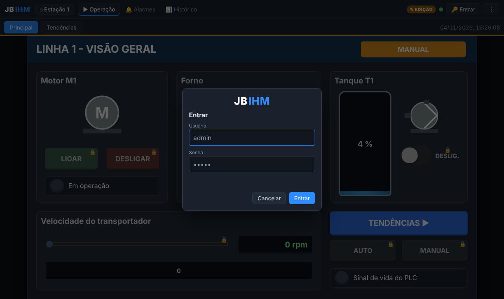

3. A IHM pede para **criar uma senha nova**. Em "Senha atual" digite `admin`, depois a nova senha duas vezes
   e clique em **Salvar senha**.

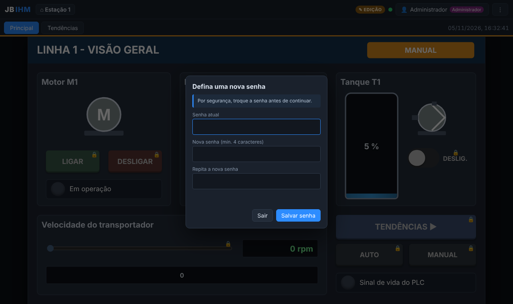

> 💡 Guarde a senha do administrador. Se esquecer, veja [Problemas comuns](#16-problemas-comuns).

---

## 3. Lista de projetos

O endereço principal (`http://IP:3000/`) mostra todos os projetos. Cada projeto é uma IHM separada, com as
próprias telas, PLCs e histórico, e tem um endereço próprio (ex.: `http://IP:3000/estacao-1/`).

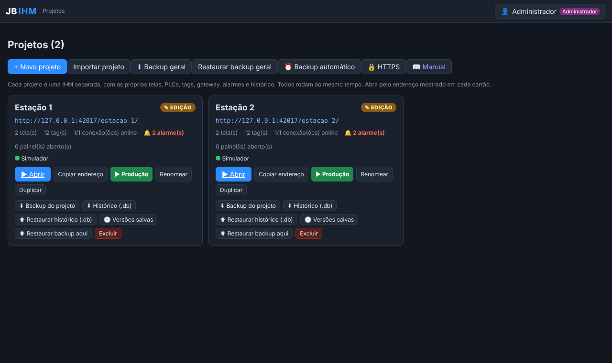

Em cada cartão:

| Botão | O que faz |
|---|---|
| **▶ Abrir** | Abre o projeto |
| **Copiar endereço** | Copia o endereço para abrir no tablet ou em outro PC |
| **▶ Produção / ✎ Editar** | Troca o modo do projeto (ver [capítulo 13](#13-modo-edição-e-modo-produção)) |
| **Renomear / Duplicar** | Muda o nome ou faz uma cópia (ótimo para criar outra estação igual) |
| **⬇ Backup / 🕘 Versões / ⬆ Restaurar** | Backups (ver [capítulo 14](#14-backup-e-restauração)) |

### Criar um projeto novo

1. Clique em **+ Novo projeto**.
2. Digite o nome (ex.: "Estação 3"). O endereço aparece embaixo (`/estacao-3/`).
3. Escolha **Projeto vazio** ou **Projeto de exemplo** e clique em **Criar**.

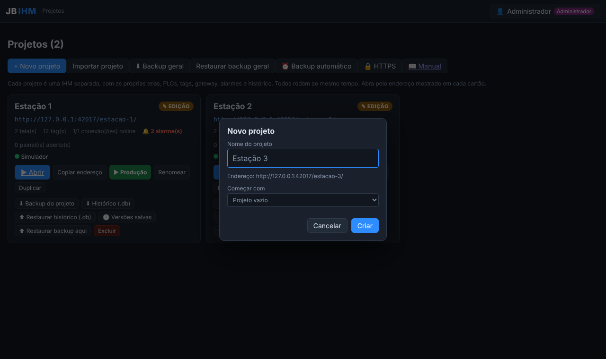

---

## 4. Operação (tela do operador)

É a tela usada no dia a dia. Os valores dos PLCs atualizam sozinhos.

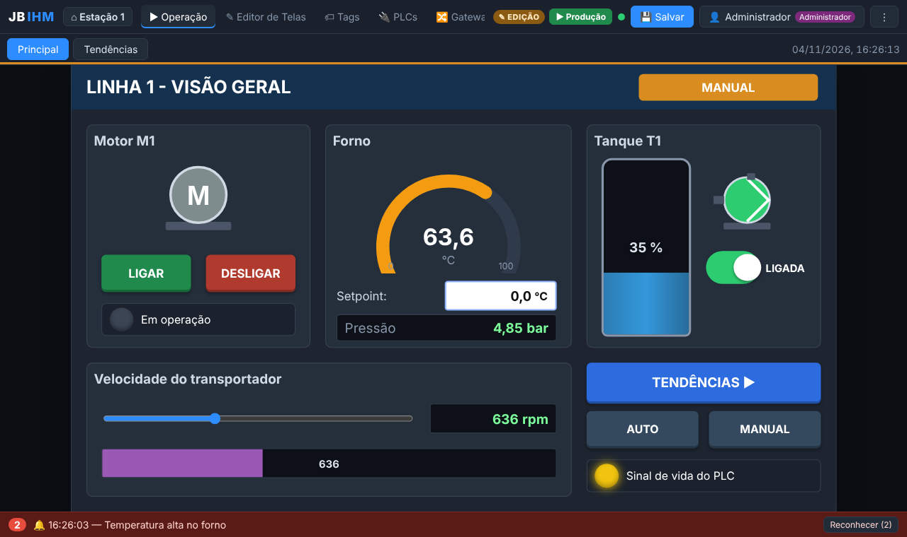

- **Menu de telas** (em cima): toque no nome para trocar de tela.
- **Botões**: LIGAR, DESLIGAR, AUTO… Alguns pedem confirmação.
- **🔒 no canto** de um botão: ele exige login com nível maior. Toque e a IHM pede o login.
- **Faixa vermelha** (embaixo): alarmes ativos. Toque nela para ver a lista; **Reconhecer** confirma que você viu.

### Digitar um valor (setpoint)

1. Toque no campo branco (ex.: Setpoint).
2. Digite no teclado da tela e toque em **OK**. Valores fora da faixa são recusados.

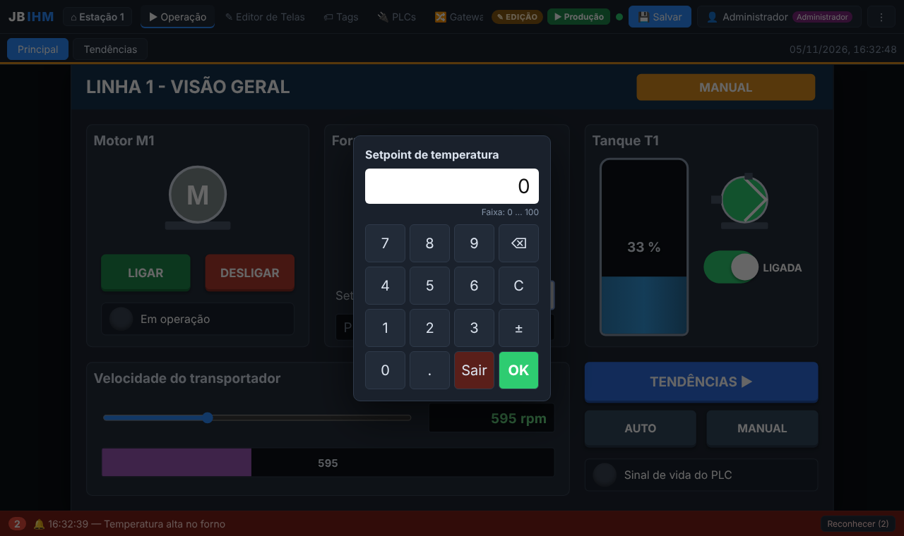

### Tendências

A tela de tendências mostra os valores ao longo do tempo. O gráfico já abre com os dados gravados.

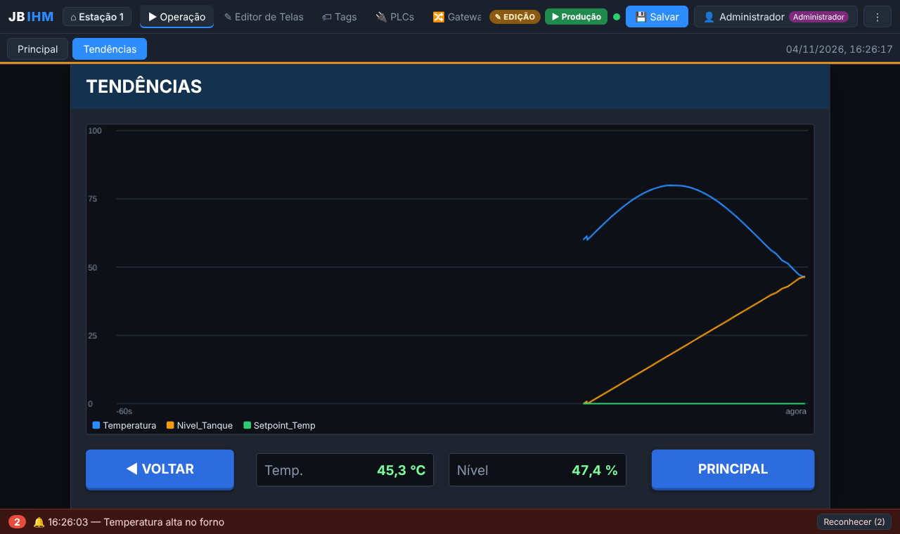

### No celular ou tablet

Abra o mesmo endereço (ex.: `http://192.168.0.10:3000/estacao-1/`). A tela se ajusta ao tamanho do aparelho.

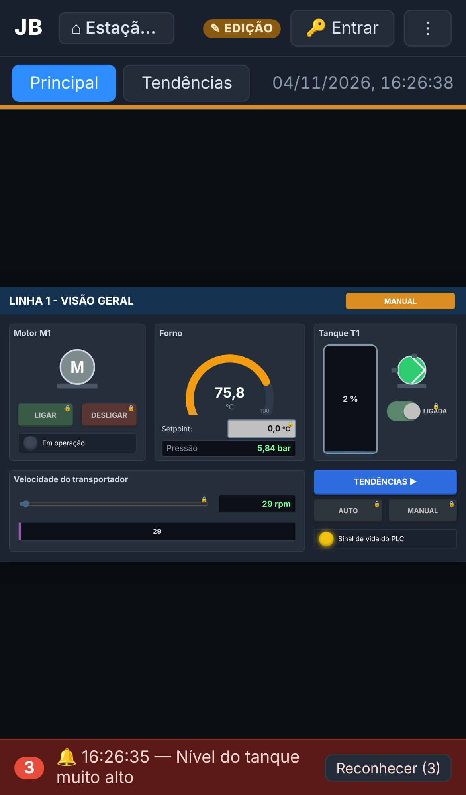

---

## 5. Editor de telas

Aba **✎ Editor de Telas** (nível Engenharia).

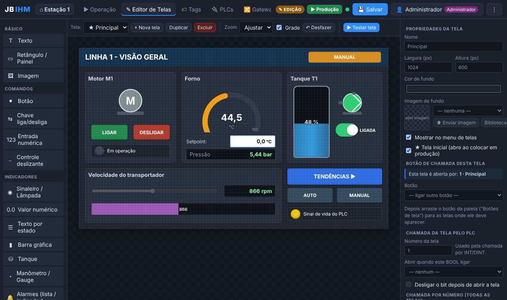

- **Esquerda (paleta)**: os objetos. Arraste para a tela ou toque para adicionar.
- **Centro**: a tela que está sendo editada.
- **Direita**: as propriedades do objeto selecionado (ou da tela, se nada estiver selecionado).
- **Barra de cima**: escolher a tela, criar (**+ Nova tela**), duplicar, excluir, zoom e **▶ Testar tela**.

### Passo a passo: colocar um botão que liga um motor

1. Arraste **Botão** da paleta para a tela.
2. No painel da direita, em **Texto**, escreva `LIGAR`.
3. Em **Ação**, escolha **Ligar (set)**.
4. Em **Tag**, escolha o tag do motor (ex.: `Motor_Liga`).
5. Escolha a cor de fundo e, se quiser, marque **Pedir confirmação**.
6. Clique em **💾 Salvar** (ou Ctrl+S) e em **▶ Testar tela**.

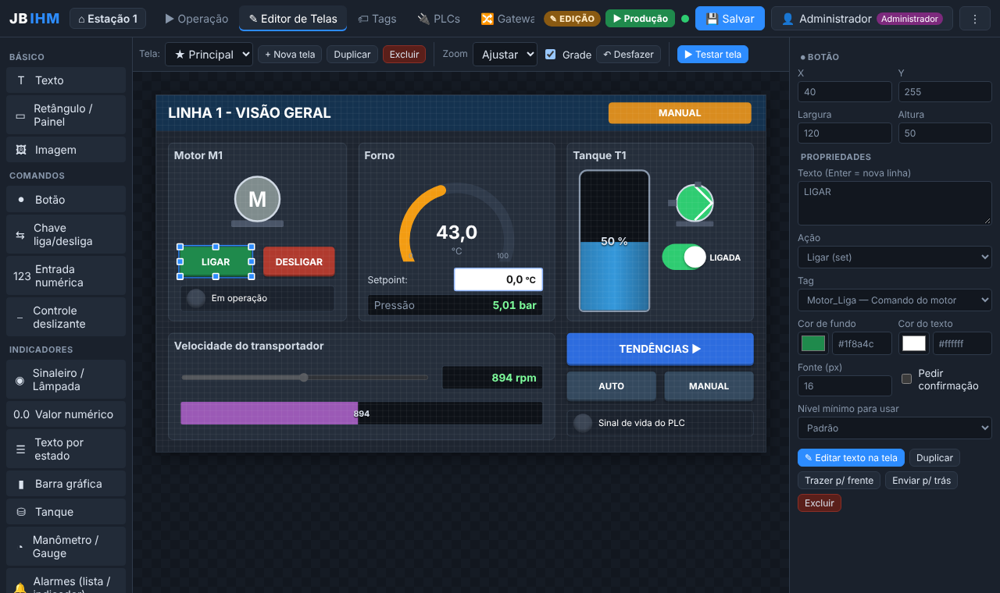

**Ações do botão:** Pulso (liga enquanto aperta) · Alternar · Ligar · Desligar · Escrever valor fixo ·
Ir para outra tela · Voltar à tela anterior.

### Mover e redimensionar

- **Mover**: arraste o objeto. As **setas** do teclado movem 1 px (Shift + seta = 10 px).
- **Redimensionar**: arraste uma das **8 alças azuis** (cantos e meio dos lados).
- **Segure Shift** enquanto arrasta para **manter a proporção** (bom para imagens). O tamanho aparece embaixo.

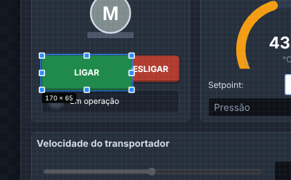

### Escrever o texto direto na tela

1. Dê **duplo clique** no botão (ou texto/sinaleiro).
2. Digite ou cole (Ctrl+V). **Shift+Enter** pula linha, **Enter** confirma, **Esc** cancela.

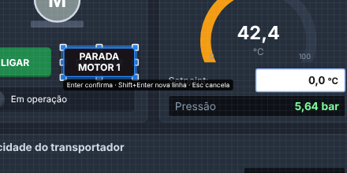

**Atalhos:** Delete apaga · Ctrl+D duplica · Ctrl+C / Ctrl+V copia e cola · Ctrl+Z desfaz.

### Propriedades da tela

Clique numa área vazia da tela para ver as propriedades dela:

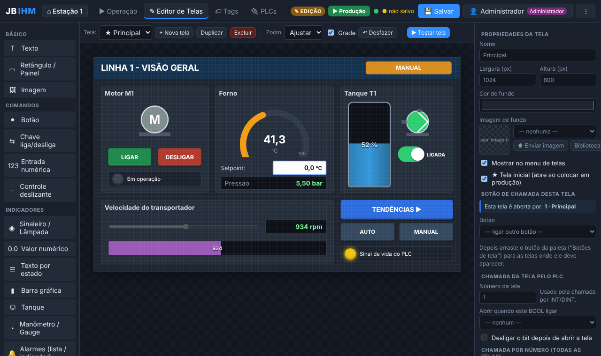

- Nome, tamanho (ex.: 1024×600 para 10"), cor e **imagem de fundo**.
- **★ Tela inicial**: a tela que abre quando o projeto vai para produção.
- **Botão de chamada desta tela**: cria um botão de tela (ver abaixo).
- **Chamada pelo PLC**: a tela abre quando um bit (BOOL) liga, ou quando o PLC escreve o número da tela num INT/DINT.

### Botões de tela (menu)

Para criar um botão que abre uma tela e usar em várias telas:

1. Selecione a tela de destino (ex.: "Configuração").
2. Nas propriedades da tela, em **Botão de chamada desta tela**, escolha **+ Criar botão para esta tela**.
3. Vá nas outras telas e arraste o botão da seção **Botões de tela** da paleta.

Mudar o texto ou a cor de um botão de tela muda **todas as cópias**.

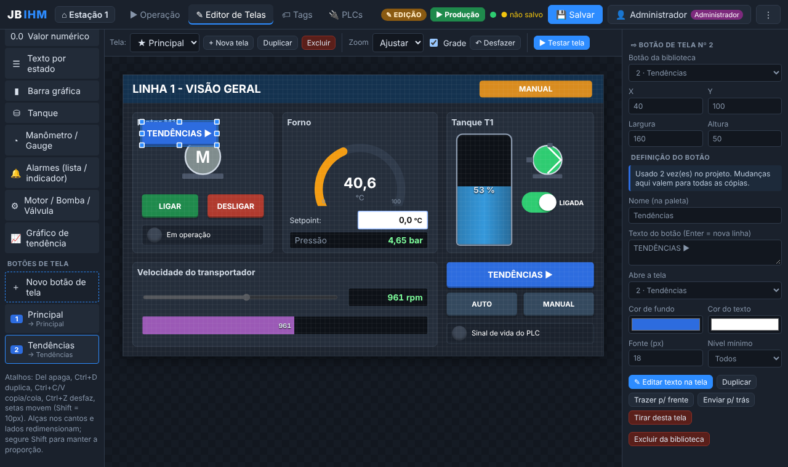

### Imagens

1. Arraste **Imagem** da paleta (ou solte um arquivo de imagem do computador direto na tela).
2. No painel, clique em **⬆ Enviar imagem** e escolha o arquivo (PNG, JPG, GIF, WEBP ou SVG, até 5 MB).
3. Opcional: escolha um **tag** e a **imagem quando o tag ligar** (ex.: máquina parada / rodando).

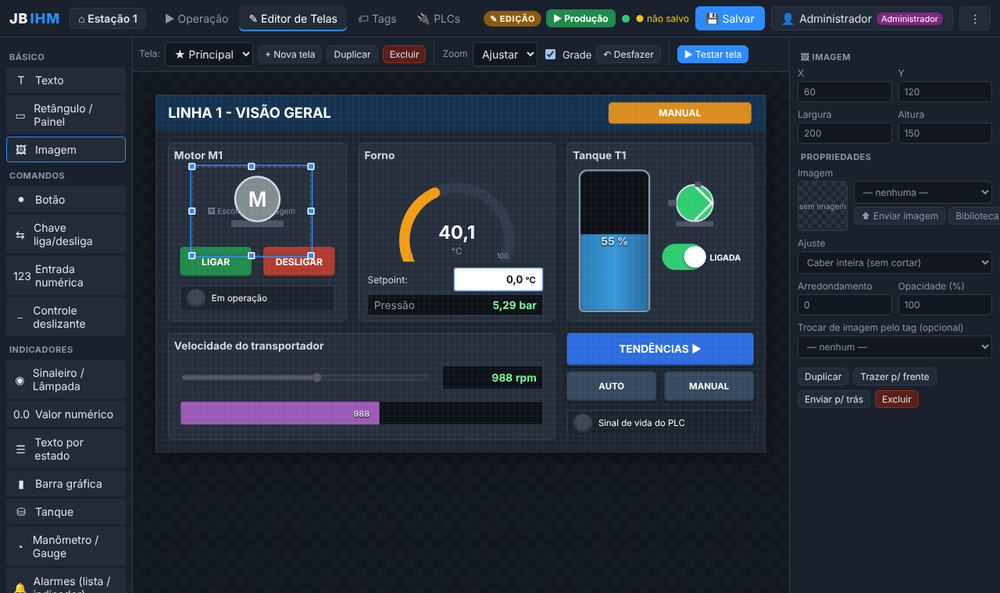

---

## 6. Conectar um PLC

Aba **🔌 PLCs** (nível Engenharia para alterar).

1. Clique em **+ Novo PLC**.
2. Em **Modelo do PLC**, escolha o modelo (Siemens, Allen-Bradley, Schneider, WEG, Delta, Mitsubishi…).
3. Preencha o **IP** e confira a porta, o rack/slot ou o Unit ID (já vêm preenchidos pelo modelo).
4. Leia o quadro azul de dicas do modelo.
5. Clique em **💾 Salvar**. A bolinha fica **verde (Online)** quando conecta.

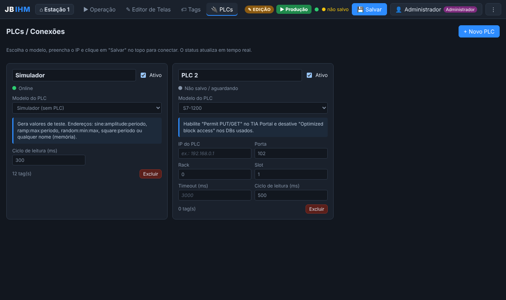

| Marca / modelo | Driver | Observação |
|---|---|---|
| Siemens S7-1200 / 1500 | S7 (porta 102, slot 1) | No TIA Portal: ligar **Permit PUT/GET** e desligar **Optimized block access** nos DBs |
| Siemens S7-300 / 400 | S7 (slot 2 / 3) | — |
| Allen-Bradley CompactLogix / ControlLogix | EtherNet/IP (slot 0) | Endereço = nome do tag no Studio 5000. Timeout de 10 s (programas com muitos tags demoram para conectar) |
| Schneider, WEG, Delta, LOGO!, Micro800, FX5U, Altus | Modbus TCP (porta 502) | Endereços HR, C, DI, IR |
| Equipamentos RS-485 | Modbus RTU | Informe a porta COM e o baud rate |
| Multímetro Rigol DM858 / DM858E | SCPI (porta 5025) | Ver [capítulo 8](#8-gateway-e-multímetro) |
| Sem PLC | Simulador | Para montar e testar as telas |

> 💡 Ciclo de leitura de 300 a 1000 ms é suficiente para a maioria das telas. Valores muito baixos aumentam a carga no PLC.

---

## 7. Tags (variáveis)

Aba **🏷 Tags**. Cada tag é um endereço do PLC com nome.

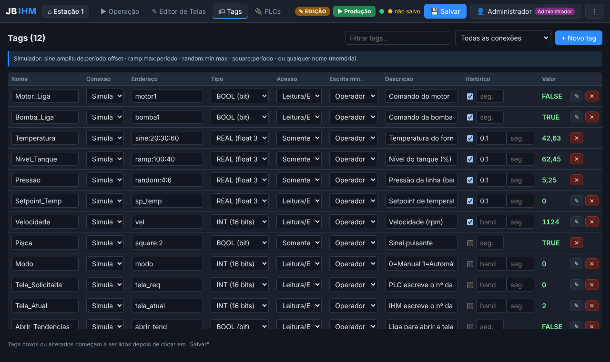

1. Clique em **+ Novo tag**.
2. Preencha: **Nome** (ex.: `Temperatura_Forno`), **Conexão**, **Endereço**, **Tipo** e **Acesso**.
3. **Escrita mín.**: nível mínimo para escrever neste tag (ex.: só Engenharia muda um setpoint).
4. **Histórico**: marque para gravar no banco; **banda** = só grava se variar mais que isso;
   **seg.** = grava no máximo 1 vez a cada X segundos.
5. A coluna **Valor** mostra o valor ao vivo. O botão **✎** escreve um valor de teste.
6. Clique em **💾 Salvar**.

### Importar tags do CompactLogix / ControlLogix

Em vez de digitar, escolha os tags na lista do próprio PLC:

1. Na aba **PLCs**, deixe marcado **"Ler lista de tags do PLC ao conectar"** e confira que o PLC está **Online**.
2. Na aba **Tags**, clique em **⬇ Importar do PLC**.
3. Busque pelo nome (ex.: `teste_ihm`, `RFID`, `Program:`), marque os tags e clique em **Criar N tag(s)**.
   Tags de programa, membros de UDT e STRING aparecem prontos; o tipo da IHM já vem certo (BOOL, INT, DINT, REAL, STRING).
4. Confira a coluna **Acesso** (leitura/escrita) e clique em **💾 Salvar**.

Para arrays, a lista mostra o elemento `[0]`: troque pelo elemento desejado depois. Tipos sem suporte (ex.: LINT) aparecem desabilitados.

**Bits de um DINT/INT/SINT como BOOL:** na coluna **Bits (BOOL)**, digite os bits que quer usar. A IHM cria um tag BOOL para cada bit,
com nome pronto. Exemplo: no DINT `explorar`, digite `0-1` → cria `explorar_0` (endereço `explorar.0`) e `explorar_1` (`explorar.1`).

| Digite | Cria |
|---|---|
| `0-7` | bits 0 a 7 |
| `0,1,5` | bits 0, 1 e 5 |
| `*` | todos (DINT: 0 a 31 · INT: 0 a 15 · SINT: 0 a 7) |

Não precisa marcar o próprio DINT para criar os bits. Bits que já existem são pulados. Se o DINT já existe na IHM,
desmarque **"Esconder os que já existem"** para vê-lo na lista. A escrita de um bit só muda aquele bit no PLC.

**Exemplos de endereço:**

| Driver | Exemplos |
|---|---|
| Siemens S7 | `DB1,REAL0` · `DB1,INT2` · `DB1,X0.0` · `M0.0` · `MW10` · `I0.0` · `Q0.1` |
| CompactLogix | `Motor_Run` · `teste_ihm` (DINT) · `teste_ihm.0` (bit do DINT, tipo BOOL) · `Program:MainProgram.Nivel` · `Receita[3]` |
| Modbus | `HR0` (holding) · `C0` (coil) · `DI0` · `IR0` · `HR0.3` (bit 3) · `40001` |
| Multímetro | `READ?` · `MEAS:VOLT:DC?` · `*IDN?` |

---

## 8. Gateway e multímetro

O **Gateway** (aba **🔀 Gateway**) copia valores entre equipamentos diferentes — por exemplo, a medida do
multímetro para uma memória do PLC, e o número da função do PLC para o multímetro.

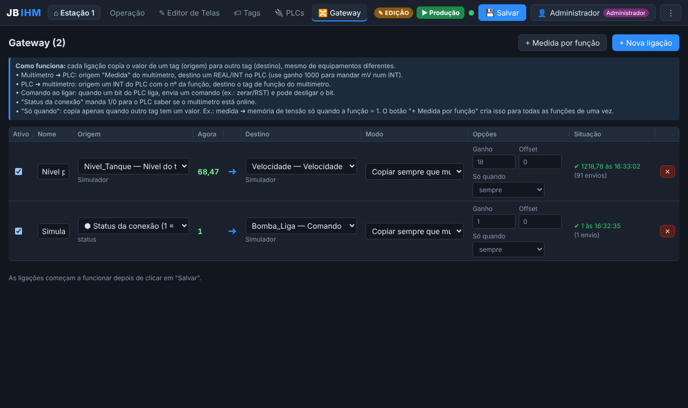

### Passo a passo: multímetro DM858E com o PLC

1. No multímetro: **Utility → IO**, configure a rede e anote o IP.
2. Aba **PLCs** → **+ Novo PLC** → modelo **Multímetro DM858 / DM858E**, preencha o IP (porta 5025) e salve.
3. No cartão do multímetro, clique em **+ Criar tags do multímetro** (Medida, Função, Reset, IDN) e salve.
4. Na aba **Tags**, crie as memórias do PLC (ex.: `PLC_Tensao_DC` em `DB1,REAL0`, `PLC_Funcao` em `DB1,INT10`).
5. Aba **Gateway** → **+ Medida por função**: para cada função escolha a memória do PLC que recebe a medida.
6. **+ Nova ligação**: origem `PLC_Funcao` → destino `DMM_Funcao` (o PLC escolhe a função).
7. Opcional: **Status da conexão** do multímetro → um bit do PLC (o PLC sabe se o multímetro está online).
8. Clique em **💾 Salvar**. A coluna **Situação** mostra cada envio.

**Funções do multímetro (número escrito pelo PLC):** 1 = tensão DC · 2 = tensão AC · 3 = corrente DC ·
4 = corrente AC · 5 = resistência · 6 = frequência · 7 = capacitância · 8 = resistência 4 fios · 9 = período ·
10 = continuidade · 11 = diodo · 12 = temperatura.

---

## 9. Alarmes

Os alarmes ficam em **duas abas**:

- **🔔 Alarmes** (operação): alarmes ativos, botão Reconhecer e últimos eventos.
- **⚙ Config. Alarmes** (Engenharia): o cadastro dos alarmes.

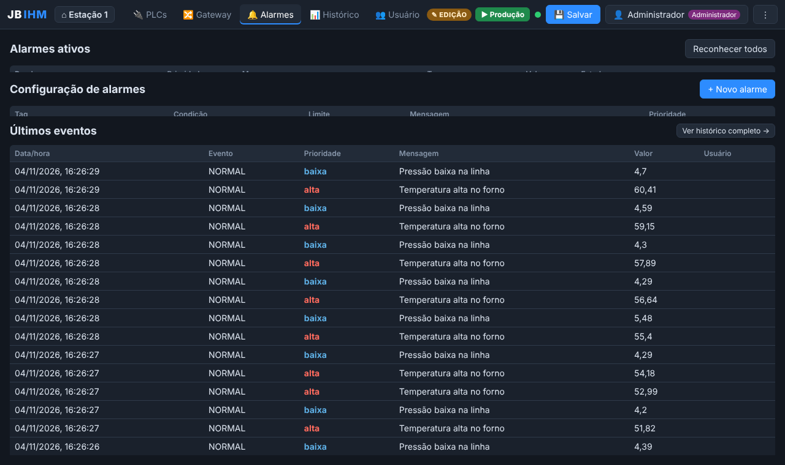

1. Na aba **⚙ Config. Alarmes**, clique em **+ Novo alarme**.
2. Escolha o **tag**, a **condição** (>, <, =, ligado…), o **limite**, a **mensagem** e a **prioridade**.
3. Salve. Quando o alarme acontece, aparece a faixa vermelha na operação.
4. **Reconhecer** confirma que o operador viu. O **histórico de eventos** guarda quem reconheceu e quando.

### Alarmes numa tela

No Editor de Telas, arraste o objeto **🔔 Alarmes (lista / indicador)** para a tela:

- **Lista de alarmes ativos**: mostra hora, prioridade, mensagem, tag e valor (escolha as colunas), com os alarmes
  sem reconhecer piscando e o botão **OK** / **Reconhecer todos**.
- **Indicador**: um quadro com a quantidade de alarmes — vermelho piscando quando há alarme sem reconhecer,
  verde com "SEM ALARMES" quando está tudo normal. Tocar nele abre a página de alarmes.
- **Mostrar a partir da prioridade**: todas, média e alta, ou só alta.

### Organizar a página de alarmes

- Clique no título de cada parte (**Alarmes ativos**, **Últimos eventos**) para
  **minimizar ou expandir**. A escolha fica guardada.
- Para **aumentar ou diminuir uma coluna**, arraste a divisória do cabeçalho, como no Excel. **Duplo clique** na
  divisória volta ao tamanho automático. Vale também para as tabelas de Tags, Gateway, Usuários e Histórico.

---

## 10. Histórico

Aba **📊 Histórico**.

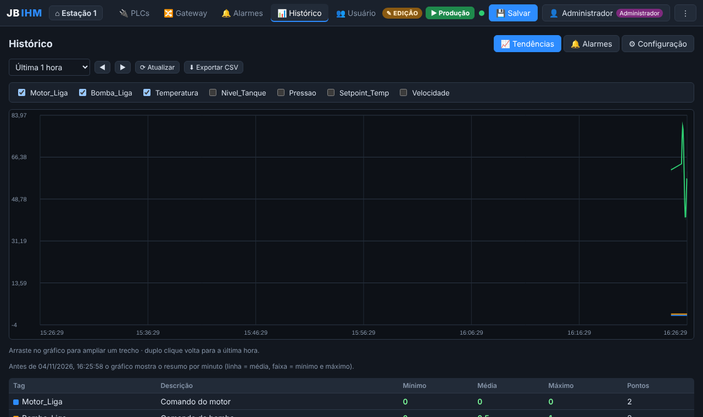

1. Marque os tags (até 8) e escolha o período (15 min, 1 h, 8 h, 24 h, 7 dias, 30 dias ou personalizado).
2. **Arraste no gráfico** para ampliar um trecho. Duplo clique volta.
3. **⬇ Exportar CSV** abre direto no Excel.
4. A aba **Alarmes** mostra todos os eventos, com filtro e exportação.

### Quanto espaço o histórico ocupa

Em **Configuração**:

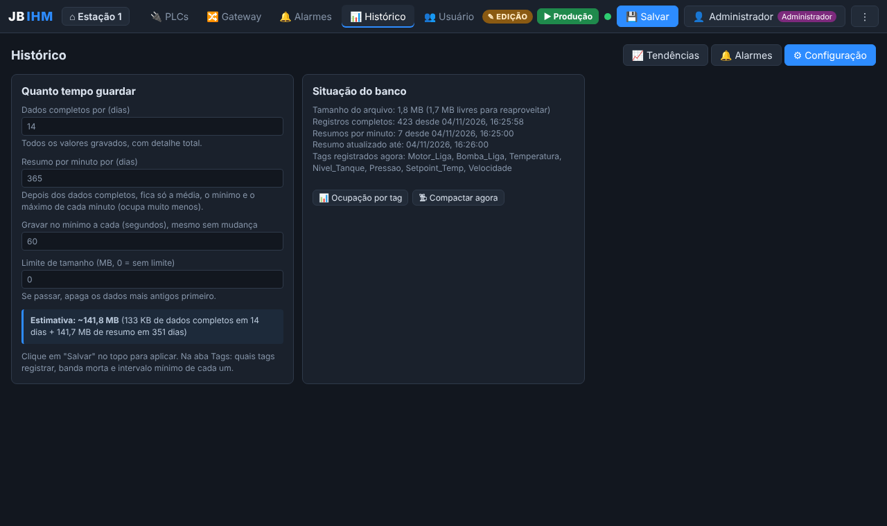

- **Dados completos por (dias)**: todos os valores (padrão 14 dias).
- **Resumo por minuto por (dias)**: depois disso fica só a média, o mínimo e o máximo de cada minuto (padrão 365).
- **Limite de tamanho**: se passar, apaga os dados mais antigos primeiro. O disco nunca enche.
- **📊 Ocupação por tag**: mostra quais tags ocupam mais. Use **banda** e **seg.** na aba Tags para reduzir.
- **🗜 Compactar agora**: devolve o espaço livre ao disco.

---

## 11. Rastreabilidade (registro por peça)

A IHM grava uma linha no banco para cada peça: data/hora, código (ex.: RFID), os valores escolhidos
(medidas, receita…), resultado OK/NOK e o operador logado. Depois dá para pesquisar pelo código e exportar
para o Excel. O banco é criado pela própria IHM (dentro do histórico do projeto) e entra no backup.

### Configurar

Aba **🔎 Rastreabilidade** → **⚙ Configurar** → **+ Novo registro**.

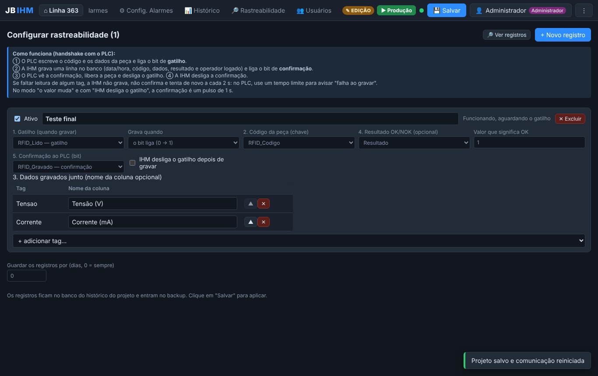

| Campo | O que é | Exemplo |
|---|---|---|
| **1. Gatilho** | Bit que o PLC liga quando os dados da peça estão prontos | `TESTE_RFID.Lido` |
| **Grava quando** | "o bit liga (0 → 1)" ou "o valor muda" (código novo, passo da máquina) | o bit liga |
| **2. Código da peça** | Tag que identifica a peça | `TESTE_RFID.Codigo` |
| **3. Dados** | Tags gravados junto. Dê um nome para a coluna (ex.: "Tensão (V)") | Tensão, Corrente |
| **4. Resultado** | Tag de OK/NOK (opcional). "Valor que significa OK": vazio = ligado/diferente de 0 | `Resultado` = 1 |
| **5. Confirmação** | Bit que a IHM liga depois de gravar | `TESTE_RFID.Gravado` |

Clique em **💾 Salvar**. A situação de cada registro aparece ao lado do nome.

### Handshake com o PLC (bit de confirmação)

1. O PLC escreve o código e os dados e **liga o gatilho**.
2. A IHM grava a linha e **liga a confirmação**.
3. O PLC vê a confirmação, libera a peça e **desliga o gatilho**.
4. A IHM **desliga a confirmação**. Pronto para a próxima peça.

Se algum tag estiver sem leitura (ex.: multímetro desconectado) ou o código estiver vazio, a IHM **não grava
e não confirma**, mostra o erro e tenta de novo a cada 2 s enquanto o gatilho estiver ligado. No PLC, use um
temporizador: se a confirmação não vier em alguns segundos, mostre "falha ao gravar rastreabilidade".

> 💡 Opção **"IHM desliga o gatilho depois de gravar"**: para PLCs que só ligam o bit e esperam ele voltar
> a 0. Nesse caso (e no modo "o valor muda") a confirmação é um pulso de 1 s.

### Pesquisar e exportar

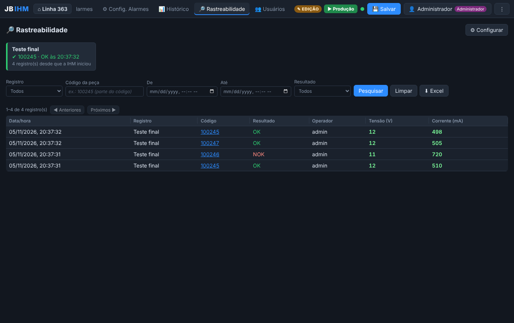

- No topo, um quadro por registro mostra a última peça gravada (ou o erro).
- Filtre por **código** (basta parte dele), **período** e **resultado** (só OK / só NOK) e clique em **Pesquisar**.
- Clique num **código** da lista para ver tudo daquela peça (ex.: reteste).
- **⬇ Excel** baixa todas as linhas do filtro em CSV.
- A lista mostra 100 por página e se atualiza sozinha quando chega uma peça nova.

Por padrão os registros ficam para sempre. Para apagar os antigos, use **"Guardar os registros por (dias)"**
na configuração.

## 12. Usuários e níveis de acesso

Aba **👥 Usuários** (só Administrador).

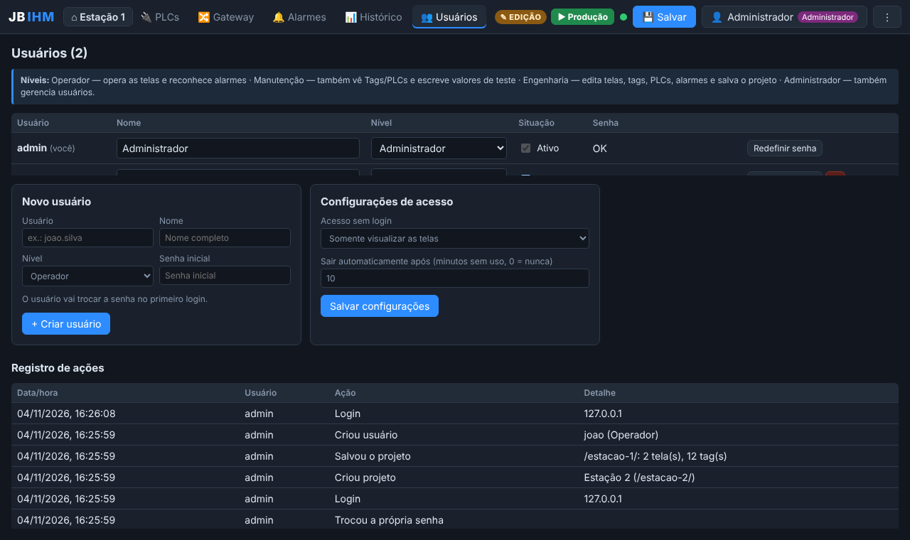

| Nível | Pode |
|---|---|
| Sem login | Configurável: bloqueado, só ver (padrão) ou operar |
| **Operador** | Usar os comandos e reconhecer alarmes |
| **Manutenção** | + ver Tags/PLCs e escrever valores de teste |
| **Engenharia** | + editar telas, tags, PLCs, alarmes e salvar |
| **Administrador** | + usuários, configurações e registro de ações |

1. Em **Novo usuário**, preencha usuário, nome, nível e senha inicial e clique em **+ Criar usuário**.
   Ele troca a senha no primeiro login.
2. Em **Configurações de acesso**: o que dá para fazer **sem login** e o **tempo para sair automaticamente**.
3. O **Registro de ações** mostra quem fez o quê e quando (logins, comandos, alterações).

---

## 13. Modo edição e modo produção

Cada projeto tem um selo no topo: **✎ EDIÇÃO** (laranja) ou **● PRODUÇÃO** (verde).

1. Com o projeto pronto, clique em **▶ Produção**.
2. Confira o alerta: tela inicial, PLCs sem comunicação, alarmes ativos.
3. Clique em **▶ Colocar em produção**.

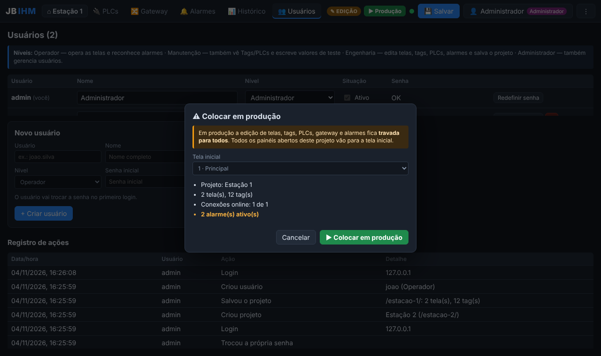

Em produção, a edição fica **travada para todos** e todos os painéis vão para a tela inicial.
Para alterar algo, clique em **✎ Editar** (a operação continua funcionando).

---

## 14. Backup e restauração

Na **lista de projetos**:

| Opção | Para que serve |
|---|---|
| **🕘 Versões salvas** | Volta para uma das últimas 30 versões (cada "Salvar" guarda a anterior) |
| **⬇ Backup do projeto** | Baixa o projeto completo (telas, tags, PLCs e imagens) em `.json` |
| **⬇ Histórico (.db)** | Baixa o banco de histórico |
| **⬆ Restaurar backup aqui** | Abre um backup por cima do projeto (a versão atual fica salva) |
| **⬆ Restaurar histórico (.db)** | Troca o histórico por um arquivo de backup |
| **Importar projeto** | Cria um projeto novo a partir de um backup |
| **⬇ Backup geral / Restaurar** | Todos os projetos num arquivo só (administrador) |

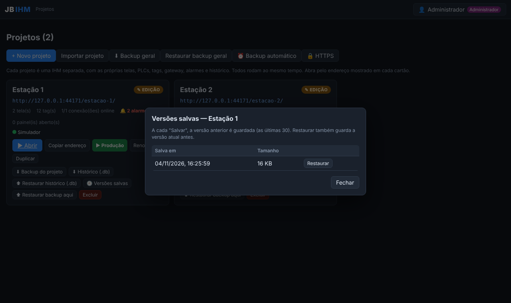

### Backup automático diário

1. Clique em **⏰ Backup automático** (administrador).
2. Marque **Ligado**, escolha o **horário**, a **quantidade de cópias** e a **pasta** (ex.: `D:\Backups\IHM` ou uma pasta de rede).
3. Clique em **Salvar configuração**. **▶ Fazer backup agora** testa na hora.

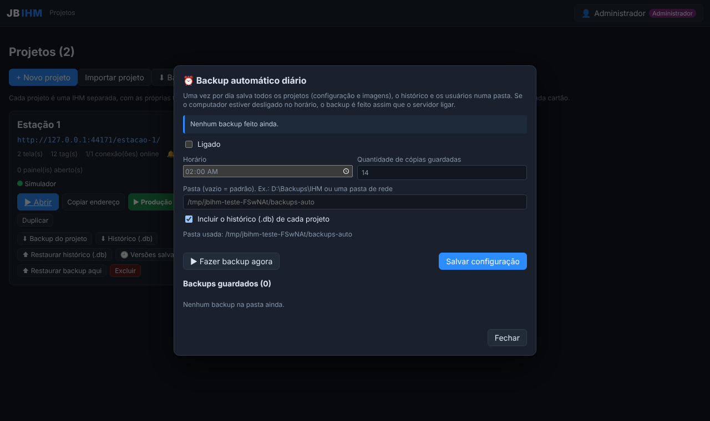

---

## 15. HTTPS (acesso seguro)

Recomendado para acesso fora da rede local (de preferência junto com uma VPN).

1. Na lista de projetos, clique em **🔒 HTTPS**.
2. Clique em **+ Gerar certificado autoassinado** (ou **Usar certificado próprio**).
3. Marque **Ligar HTTPS**, confira a porta (3443) e clique em **Salvar**.
4. Acesse por `https://IP:3443/`. Na primeira vez o navegador avisa sobre o certificado:
   clique em **Avançado → Continuar**, ou instale o certificado (**⬇ Baixar certificado**) nos aparelhos.

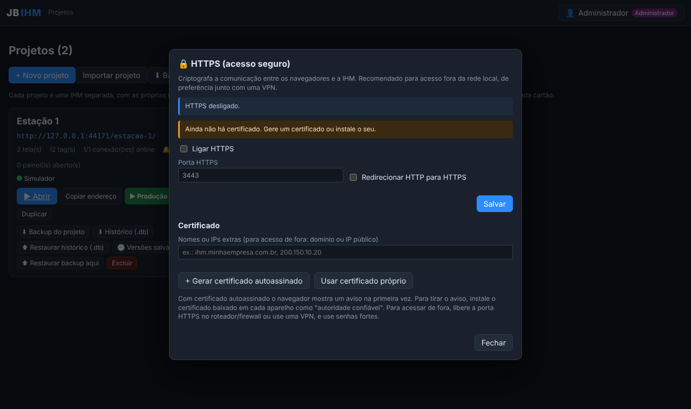

> ⚠️ Para acesso pela internet, use senhas fortes e deixe "Acesso sem login" como **Bloqueado** (aba Usuários).

---

## 16. Problemas comuns

| Problema | O que fazer |
|---|---|
| **Esqueci a senha do admin** | Feche o `iniciar_ihm.bat`, apague o arquivo `data\users.json` e abra de novo: volta `admin`/`admin`. Os outros usuários são perdidos; projetos e histórico não. |
| **Outros PCs/tablets não abrem a IHM** | Libere o Node.js no Firewall do Windows (Redes privadas). Use o IP mostrado na janela preta, com `:3000`. |
| **"A porta 3000 já está em uso"** | Outro programa usa a porta. Edite `iniciar_ihm.bat` e troque `set PORT=3000` por outra (ex.: 3001). |
| **CompactLogix dá "Tempo esgotado" ou "PLC desconectado"** | Aumente o **Timeout** para 10000 ms no cartão do PLC (padrão desta versão). Se ainda falhar, desmarque "Ler lista de tags do PLC ao conectar". |
| **PLC Siemens não conecta** | Confira IP, rack/slot e se o PC "pinga" o PLC. No TIA Portal: Permit PUT/GET e DBs sem acesso otimizado. |
| **Valor aparece riscado (cinza)** | Qualidade ruim: o PLC não respondeu ou o endereço está errado. Veja o status na aba PLCs. |
| **Modbus mostra valor estranho em REAL/DINT** | Marque **Inverter words (CDAB)** no cartão do PLC. |
| **Multímetro mostra "OL"** | Sobrecarga: medida fora da faixa do instrumento. |
| **Não consigo editar nada** | O projeto está em **produção** (selo verde): clique em **✎ Editar**. Ou seu nível não é Engenharia. |
| **O histórico está grande** | Histórico → Configuração: reduza os dias, use limite de tamanho e, na aba Tags, banda e seg. |
| **Atualizei o programa e quero conferir** | Dois cliques em `testar_ihm.bat`: todos os testes devem passar. |

---

*JB IHM — manual gerado com as telas da versão atual. O `README.md` do projeto tem os detalhes técnicos.*
